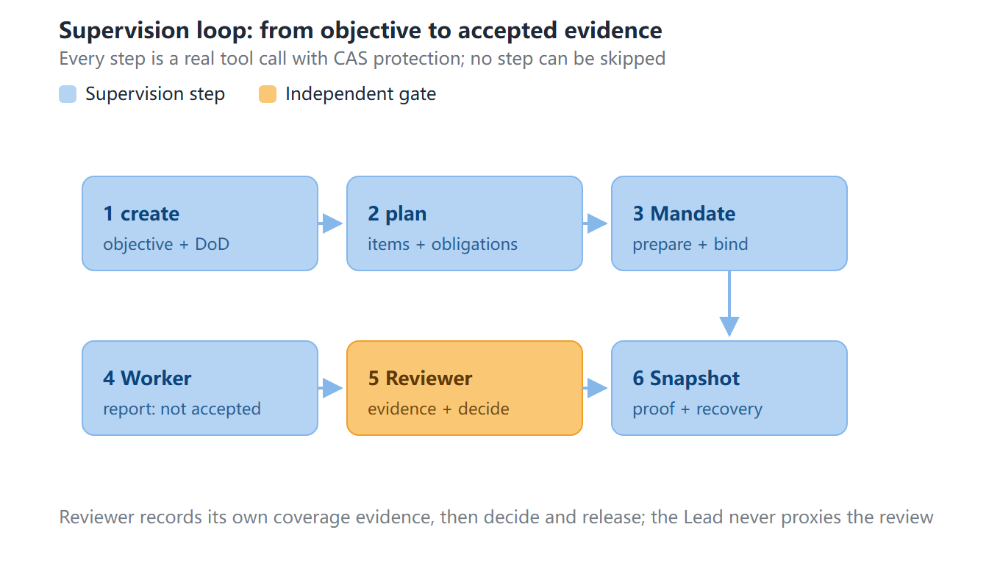

# SuperAgent PTC

[](README.en.md) [](README.md)

<p align="center">
  
</p>

[](https://www.npmjs.com/package/dsh-superagent-ptc)
[](https://www.npmjs.com/package/dsh-superagent-ptc)
[](LICENSE)
[](https://github.com/deepseek-ai/deepseek-harness)
[](docs/VALIDATION.md)

> **Long-task supervision layer for DeepSeek Harness** — versioned anchors, bounded delegation, independent acceptance, evidence-gated release.

SuperAgent PTC turns "the agent says it is done" into "an independent reviewer proved it is done". It is a **preset-first** plugin: it adds a supervision plane on top of the native PTC / Agent / Goal / Teams runtime instead of building a second agent loop, task board or router.

```
You:  split this research into three items, accept each one, then write the summary
PTC:  Run + Anchor  ->  Mandate per item  ->  standard Reviewer verifies independently
      ->  gate passes  ->  super_snapshot returns revision and proof
```


## Contents

- [Why](#why-superagent-ptc)
- [Features](#features)
- [Dual-layer architecture](#dual-layer-architecture)
- [Supervision loop](#supervision-loop)
- [Install](#install)
- [Quick start](#quick-start)
- [Tools](#tools)
- [Right panel](#right-panel)
- [Evidence gates and boundaries](#evidence-gates-and-boundaries)
- [Compatibility](#compatibility)
- [Verification](#verification)
- [FAQ](#faq)
- [Development](#development)
- [Contributing](#contributing)
- [Community and feedback](#community-and-feedback)
- [Friendly links](#friendly-links)
- [Acknowledgements](#acknowledgements)
- [Risk notice and disclaimer](#risk-notice-and-disclaimer)
- [License](#license)

## Why SuperAgent PTC

Long tasks rarely fail because the model cannot write code. They fail because four things stay unconstrained:

| Problem | Consequence | What SuperAgent PTC does |
| --- | --- | --- |
| The goal drifts across a long conversation | Half the work targets the wrong thing | **Versioned Anchor**: objective, DoD and obligations have versions; corrections explicitly invalidate affected work |
| The agent declares itself done | "Done" without verification | `reported_done != accepted`: an independent Reviewer and an evidence gate must pass first |
| Delegation has no boundary | Workers overreach or duplicate effort | **Mandate contract**: work item, write scope, model route and attempt count are frozen at prepare time |
| Crash leaves an unknown state | You cannot tell what is trustworthy | **SnapshotProof + RunState v2**: write the native proof, then storage, then swap the live core |

## Features

- **Preset-first**: one agent preset (`SuperAgent PTC`) alongside Standard, Creative, PTC and Minimal; it does not change default models, permissions or other sessions.
- **Seven supervision tools**: `super_run`, `super_anchor`, `super_mandate`, `super_evidence`, `super_review`, `super_route`, `super_snapshot`, all called through PTC `run_code` instead of adding new script tools.
- **Native identity binding**: Worker and Reviewer are real native subagents; the Host wakes a bound Reviewer through native `sendMessage`, so the Lead can never play the Reviewer.
- **Six Worker rules**: every `prepare` writes no silent rerouting, read before edit, no write-scope expansion, graded ambiguity, acceptance-based verification and evidence-backed reporting into `mandateText` for verbatim delivery.
- **Explicit manual handoff**: after `bind`, the Lead reads the current CAS from `super_snapshot`, reads the current `mandateText` through `super_mandate show`, and forwards it verbatim with only one `ACTION NOW` line; this phase has no automatic `dispatch`.
- **Independent read-only review**: the Reviewer must use the native `standard` preset; the guard fails closed on writes and unknown shell operations, while `pwsh` read commands (including `$env:` reads) are classified by their actual arguments.
- **Typed evidence gates**: evidence is `pass / fail / unknown` only; `unknown` never releases; build logs, unit tests and screenshots cannot replace runtime evidence.
- **Failure budgets and recoverable audit**: the same fingerprint reaching its budget blocks the run; `super_run recover` increases the generation and keeps the full audit trail.
- **Client visualization**: a right-side supervision panel and a conversation/subagent entry over a read-only projection; no composer dock is registered.
- **No global side effects**: ordinary sessions get no `super_*` tools, no prompt section and no panel.

### What it deliberately does not do

| Not doing | Reason |
| --- | --- |
| Rebuilding an agent loop, task board or global router | Native Session, Agent, Goal and Teams remain the execution authority |
| Providing an OS-level file permission sandbox | Write scopes are a coordination contract, not kernel isolation |
| Automatic model downgrade | Only explicit, allowlisted, budgeted bounded failover is supported |
| Treating `reported_done` as acceptance | Only an independent Reviewer plus the evidence gate produces `accepted` |

## Dual-layer architecture

**One-sentence positioning**: SuperAgent PTC layers a supervision state machine (`Run -> Anchor -> Mandate -> Evidence -> Decision`) on top of the native Agent/Session mechanism, binds native agent sessions into that chain by role (Lead / Worker / Reviewer), and treats the **native PTC event chain** (`run_code` calls and tool receipts) as the **evidence substrate** of the whole chain. The supervision layer never produces a second event stream.

The supervision plane only answers "may this ship"; the execution plane only answers "what actually happened". Between them sits a single contract membrane: `super_*` tools are the only writer of state and evidence.


- **A Supervision plane**: the Lead maintains the Anchor and the obligation ledger; a Mandate freezes work item, write scope, route and attempt; evidence gates and budgets decide release.
- **Contract membrane**: every state change must pass the `super_*` CAS check; there is no second write path between the planes.
- **B Execution plane**: PTC `run_code` orchestrates host tools, native `subagent` creates Worker and Reviewer, and receipts come back as `reported_done` plus tool results.
- **Shared foundation**: the native runtime supplies identity, lifecycle and proof; `storageDomain RunState v2` and `SnapshotProof` make the run recoverable.

## Supervision loop



```text
super_run create            # objective + definition of done + gate policy
super_run plan              # work items / dependencies / obligations (open ledger)
super_anchor                # versioned anchor; corrections invalidate affected work
super_mandate prepare       # freeze work item, write scope, model route, attempt
super_mandate bind          # bind the native Worker SessionId
# Lead: read CAS from super_snapshot and mandateText from super_mandate show,
#       forward verbatim with native send_message plus one ACTION NOW line
super_evidence record       # Worker execution and build/unit receipts
super_mandate report        # Worker reports done, entering reported_done
super_mandate bindReviewer  # bind and wake a standard Reviewer only after reported_done
super_evidence verify       # Host verifies native delivery and records coverage when required
super_review evaluate       # gate evaluation
super_review decide/release # release only when the gate passes
super_snapshot              # read-only check of revision / generation / proof
```

### Mandate handoff and Worker discipline

In addition to freezing the work item, anchor/generation/attempt, write scopes, acceptance and routes, `prepareMandate` generates six Worker execution rules. These are a **core-generated, test-covered message contract**; whether they steer a real model must be observed in a native delegation loop.

1. **No silent rerouting**: execute only the current Mandate and `ACTION NOW` and keep its objective, acceptance, write scopes and selected approach; local implementation choices are allowed, but never change the task boundary on your own.
2. **Read before edit**: inspect every target and its current content before editing; match the existing style of the surrounding code and do not refactor unrelated code.
3. **Stay within write scopes**: when the goal genuinely needs something outside them, finish the in-scope part that can be delivered on its own and report the rest to the Lead instead of expanding scope.
4. **Grade ambiguity**: resolve discoverable facts by inspection and record minor assumptions; when ambiguity affects the objective, acceptance, security, public interfaces, write scopes or irreversible actions, report `NEEDS_LEAD_DECISION` to the Lead instead of guessing.
5. **Verify against acceptance**: run the required checks and preserve real receipts; label unrun or unsupported checks unknown.
6. **Report with evidence**: include changed files, commands, receipts, artifacts, assumptions, failures, unfinished work and risks; your final answer and any message to the Lead must themselves carry the result and the evidence, because the completion notice omits your final answer when you send the Lead a message just before finishing.

After a successful `bind`, the Lead reads the current CAS from `super_snapshot`, reads the **current** `mandateText` through `super_mandate show`, and sends it verbatim to the bound Worker through native `send_message`, appending only `ACTION NOW: <current action>`. The Lead must not rewrite the contract, hand-copy IDs/CAS from memory or invoke a nonexistent `dispatch` action.

For independent delivery verification, call `super_evidence verify` with `verification=mandate_delivery` and select `kind=coverage` or `kind=host_contract` according to the contract. The Host compares the current Mandate sent by the Lead with the Worker's native inbound message and records source-bound evidence. A coverage obligation must explicitly declare `verification=mandate_delivery`; one ordinary delivery cannot close unrelated obligations such as observed-results-only reporting or stale-instruction stopping. Shell-printed `result=pass`, Worker-reported coverage, or an unbound Reviewer's self-report is not independent proof.

When the latest Decision is `unknown` and the work item is stuck at `verifying`, explicitly replan with every contract field unchanged, open a new attempt and collect fresh evidence instead of creating an A2 workaround. A contract correction requires explicit user authorization: call `super_run replan` with `instruction`, any necessary `obligationDelta`, and complete `workItemRevisions`, then `plan` under the new Anchor. History is retained and recovery cannot weaken the gate silently.

A Worker stands by until it receives the complete current Mandate and action. Material ambiguity is escalated to the Lead; minor assumptions are disclosed in the report. On a blocker, replan, new anchor or new attempt, the old action is abandoned: read the latest snapshot and wait for a fresh Mandate. Reports distinguish observed receipts, unrun checks and risks.

**Boundary**: prompts and message contracts do not replace core transitions, native identity binding, the read-only Reviewer, evidence gates or write-scope management. Three scenarios in an isolated profile—standby before work, reporting only observed results, and stale instructions after replanning—require separate live validation; unit tests cannot prove them.

## Install

Requires DSH `>=0.2.2-rc.5 <0.3.0-0` and Node `^22.19.0 || >=24`.

```bash
# install from npm into the current profile
dsh plugin --profile desktop add dsh-superagent-ptc
```

Restart DSH completely after installing, then create a session and pick **SuperAgent PTC** in the preset selector.

### Install through the DSH plugin market index

In DSH -> Settings -> Plugins -> Discover, add this index URL and search for `SuperAgent PTC`:

```text
https://raw.githubusercontent.com/BioAIEvolu/dsh-superagent-ptc/main/market-index.json
```

The index passes the official `parseMarketIndex` validation and resolves to the current npm release shown in the badge above.

### Local development install

```bash
git clone https://github.com/BioAIEvolu/dsh-superagent-ptc.git
dsh plugin --profile desktop add link:/absolute/path/to/dsh-superagent-ptc
```

## Quick start

1. Create a session and choose the **SuperAgent PTC** preset.
2. Describe the objective and the definition of done, for example:

```text
Use SuperAgent PTC for a minimal supervision loop:
super_run create a Run; plan two work items, W1 reads the README and lists 3 points, W2 depends on W1 and stays held this phase;
let the Worker inherit super-agent and the Reviewer use agent_preset=standard;
after prepare/bind, the Worker executes and reports; only after reported_done does bindReviewer wake the Reviewer, who records coverage evidence and runs evaluate/decide/release;
finally call super_snapshot and report the real Run/WorkItem/Mandate/Evidence/Decision IDs plus revision/generation/proof.
```

3. Open **SuperAgent PTC** from the conversation/subagent area to view the live run and audit timeline in the right panel.

## Tools

| Tool | Actions | Notes |
| --- | --- | --- |
| `super_run` | `create` `plan` `show` `replan` `recover` `complete` | Run lifecycle; `replan` supports user-authorized contract revisions and `recover` increases the generation |
| `super_anchor` | `create` `show` `history` | Versioned anchors; corrections explicitly invalidate affected work |
| `super_mandate` | `prepare` `bind` `bindReviewer` `report` `show` | Delegation contract and native SessionId binding |
| `super_evidence` | `record` `observe` `verify` `list` | Typed evidence and dedicated Host verification with source-role checks |
| `super_review` | `evaluate` `decide` `release` | Independent acceptance and release |
| `super_route` | `show` `set` `inspect` `switch` | Model policy for the current run with bounded failover |
| `super_snapshot` | `{}` | Read-only check of Run / gate / proof / recovery |

Every write action carries `expectedRevision` and `expectedGeneration`; conflicts are rejected instead of silently overwritten.

## Right panel


- The panel is a **read-only projection**: objective/Anchor, model policy and routing audit, work items, Mandate, evidence and gates, audit timeline, agenda/attempt.
- It never writes state; only `super_*` tools can change state, through the Host CAS check.
- The conversation/subagent entry never blocks input and is invisible in ordinary sessions.

## Evidence gates and boundaries

| Rule | Behavior |
| --- | --- |
| Three evidence states | Only `pass` may release; `fail` blocks; `unknown` is never treated as success |
| Source roles | Evidence must come from an allowed role and write scope; evidence reused across items is marked stale |
| Reviewer read-only | Writes, unknown shell commands and privilege escalation fail closed; read commands are classified by arguments |
| Commit order | `SnapshotProof` -> `storageDomain` -> live core; any failed step aborts |
| Recovery | `recover` increases the generation and old evidence is not reused; only the root Lead may clear quarantine |
| Sandbox scope | This plugin does not provide an OS-level file sandbox; write scopes are a coordination contract |
| Trust boundary | SnapshotProof relies on the native session log and does not defend against a malicious host or direct log tampering |

## Compatibility

| Item | Value |
| --- | --- |
| DSH | `>=0.2.2-rc.5 <0.3.0-0` (validated on `0.2.2-rc.5`) |
| Node | `^22.19.0 || >=24.0.0` |
| Host peers | `dsh-session`, `dsh-storage-domain`, `dsh-tools`, `react` |
| Client | web surface; `@deepseek-ai/dsh-client-connection`, `ui-conversation`, `ui-sidebar-right`, `ui-subagent` |

## Verification

- Automation: **214 / 214 pass**; `typecheck` and `build` both exit 0.
- New supervision regressions cover same-contract replanning after `unknown`, user-authorized contract revisions, native PTC outbound/inbound delivery verification, forged-evidence rejection, Reviewer wake-up after `reported_done`, and independent route switching.
- Real desktop runs: two independent Electron sessions completed supervision loops, including recovery across generations, repeated Anchor revisions, independent Reviewer release and SnapshotProof agreement.
- Fixes recorded: the Reviewer read-only guard once classified `pwsh "$env:NAME"` as a write; it now classifies by arguments and has regression tests.
- Phase A adds six Worker rules and verbatim Lead forwarding after bind; the three isolated-profile live delegation scenarios (standby before work, observed-results-only reporting, invalidating old instructions after replanning) have been released by an independent native standard Reviewer, and original work item A is accepted. Details in [docs/VALIDATION.md](docs/VALIDATION.md).
- 0.1.11 aligns the six rule texts with the approved design clause by clause (0.1.10 dropped four sub-clauses while implementing) and the core test now asserts every sub-clause; the rules remain a text contract and this release adds no live behaviour validation.
- Details: [docs/VALIDATION.md](docs/VALIDATION.md).

### Known unknown

- Live provider-failure failover, budget-exhaustion blocking and `model.select` failure branches have never occurred on real hardware and remain unknown.
- No OS-level file sandbox; no security boundary beyond session isolation.

## FAQ

**I selected the preset but there are no `super_*` tools.**
Only `super-agent` sessions and a verified, bound read-only Reviewer receive the tools. Confirm the preset actually switched and restart DSH completely.

**The Reviewer cannot decide.**
Read the gate response: `missingEvidence` / `staleEvidence` means you need new evidence; `REVIEWER_NOT_READONLY` means the Reviewer produced a write receipt and must be replaced by a fresh read-only Reviewer. If the write is discovered after a pass decision, release is rejected and a direct replan/revise is forbidden while the current gate still passes. Use `super_run recover` to advance the generation, then replan with the same contract, bind a fresh Reviewer and attempt, collect fresh evidence, and only then decide/release. A direct same-contract replan is available only when contradictory evidence makes the current gate non-passing.

**How do I recover after a crash?**
The root Lead calls `super_run recover`; the generation increases, old evidence is not reused, and new evidence must be collected in the new generation.

**Can it act as a global router or automatic downgrade?**
No. `super_route` only manages an explicit policy for the current run; there is no out-of-the-box global auto-router.

## Development

```bash
pnpm install
pnpm typecheck && pnpm build && pnpm test
```

- Layout: `src/core` (pure state machine, no Host dependency), `src/host` (tools, guard, routing, storage), `src/client` (panel and entry), `test/`.
- Keep `typecheck`, `build` and `test` green; core state-machine changes need positive and negative cases.
- Issues and PRs: https://github.com/BioAIEvolu/dsh-superagent-ptc/issues

## Contributing

Issues and PRs are welcome:

- **Reporting a problem**: open a GitHub [issue](https://github.com/BioAIEvolu/dsh-superagent-ptc/issues) with your DSH version, reproduction steps, expected vs. actual behavior; sanitize logs before pasting.
- **Proposing changes**: fork, branch, and keep `pnpm typecheck && pnpm build && pnpm test` green; changes to the core state machine (`src/core`) need both positive and negative test cases.
- **Stay focused**: one thing per PR, no unrelated refactoring; describe what changed and how you verified it (commands and receipts) in the PR description.
- **Security-sensitive reports**: do not paste secrets or raw logs into public issues — sanitize first, and say what you removed.

## Community and feedback

- **Issues and ideas**: [GitHub Issues](https://github.com/BioAIEvolu/dsh-superagent-ptc/issues)
- **Plugin markets**: [awesome-dsh-plugin](https://github.com/awesome-dsh-plugin/awesome-dsh-plugin), or DSH -> Settings -> Plugins -> Discover (index URL in [Install](#install))

This project grew out of a real group discussion (see [Acknowledgements](#acknowledgements)); bring back your real long-task delegation stories, failures and ideas.

## Friendly links

- **[DeepSeek Harness](https://github.com/deepseek-ai/deepseek-harness)**: the platform this plugin runs on.
- **[awesome-dsh-plugin](https://github.com/awesome-dsh-plugin/awesome-dsh-plugin)**: the curated DSH plugin directory; this plugin is listed.
- **[DSH Go](https://github.com/ccch1mneyyy/dsh-Go)**: DSH on your phone.
- **Sibling plugins by the same author**: [dsh-md-studio](https://github.com/BioAIEvolu/dsh-md-studio) (Markdown rendering), [dsh-token-tally](https://github.com/BioAIEvolu/dsh-token-tally) (token usage), [dsh-pane-find](https://github.com/BioAIEvolu/dsh-pane-find) (in-panel find).

## Acknowledgements

This plugin did not appear from thin air. It grew out of a real group discussion and source share on 2026-11-17:

- **CC**, a community member, shared the `dsh-plugin-antidrift` plugin source and real long-run experience (setting a long-term `/goal`, a single run lasting 30+ hours, ten agents writing in parallel). We only read the source for forensics — it was never installed, executed or copied — and its "anchor + delegation + audit" framing was an early inspiration.
- **An** proposed deploying several instructions at once with a small audit every few steps, which maps directly to the work item / evidence gate / failure budget trade-off here.
- **Electron** read this shape as an extension of PTC, which pushed us to state that PTC only exposes `run_code` and that supervision must sit on its native event chain.
- **KOLA 2** proposed polling progress and releasing the next instruction plus audit on completion, and the "main router controlling workers" SuperAgent idea; these shaped Mandate unlock semantics and the Lead/Worker/Reviewer split.

Thanks also to upstream [zouyuanqing/dsh-super-ptc-mode](https://github.com/zouyuanqing/dsh-super-ptc-mode) (MIT): we referenced its thin preset composition and Lead delegation doctrine, then rewrote the persona and composition for the current DSH contract. License and provenance are preserved in [NOTICE.md](NOTICE.md).

And thanks to everyone who kept discussing, asking and correcting in that group — those conversations turned "evidence-gated release" from a slogan into a state machine.

## Risk notice and disclaimer

This plugin is a community-built third-party project. It is not affiliated with and does not represent DeepSeek. Before using it, please understand:

- **Supervision is best-effort, not a sandbox**: the Worker contract, evidence gates and the read-only Reviewer constrain the state machine and the workflow, not the operating system. `run_code` and host tools can still make real file changes and run real commands; define write scopes and acceptance before delegating long tasks.
- **Costs**: model requests are billed by your configured provider; long tasks and parallel agents amplify usage and wall-clock time.
- **Review important results yourself**: the evidence gate proves "accepted per contract", not "correct"; keep a human in the loop for irreversible operations (deletion, publishing, outbound messages).
- **No warranty**: the software is provided "as is" under MIT, without warranty of any kind; see [LICENSE](LICENSE).

## License

MIT, see [LICENSE](LICENSE). Upstream DSH component notices are recorded in [NOTICE.md](NOTICE.md).
