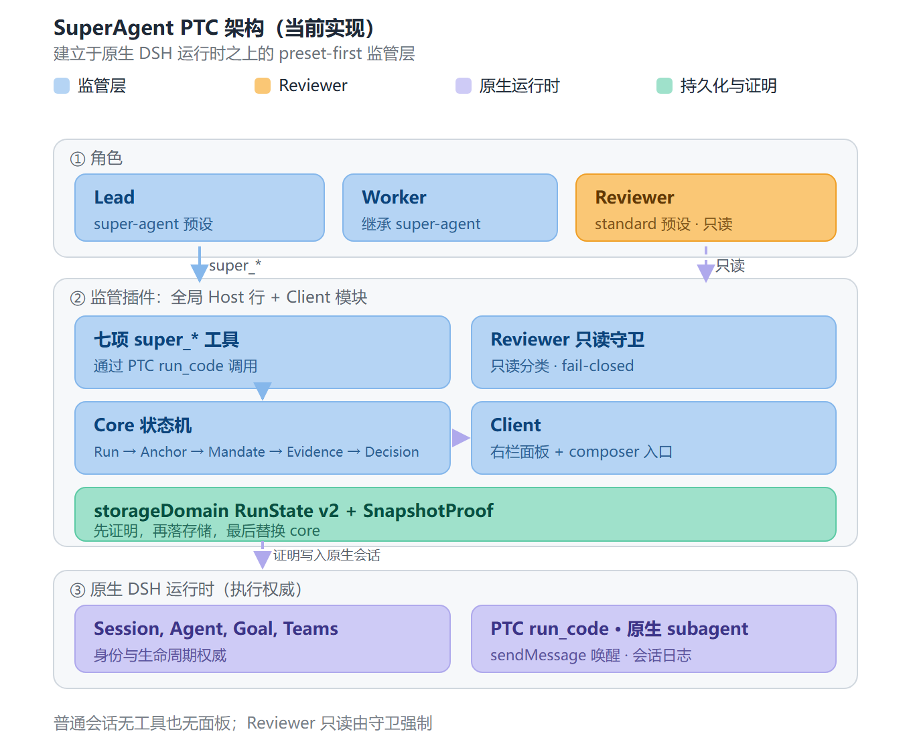
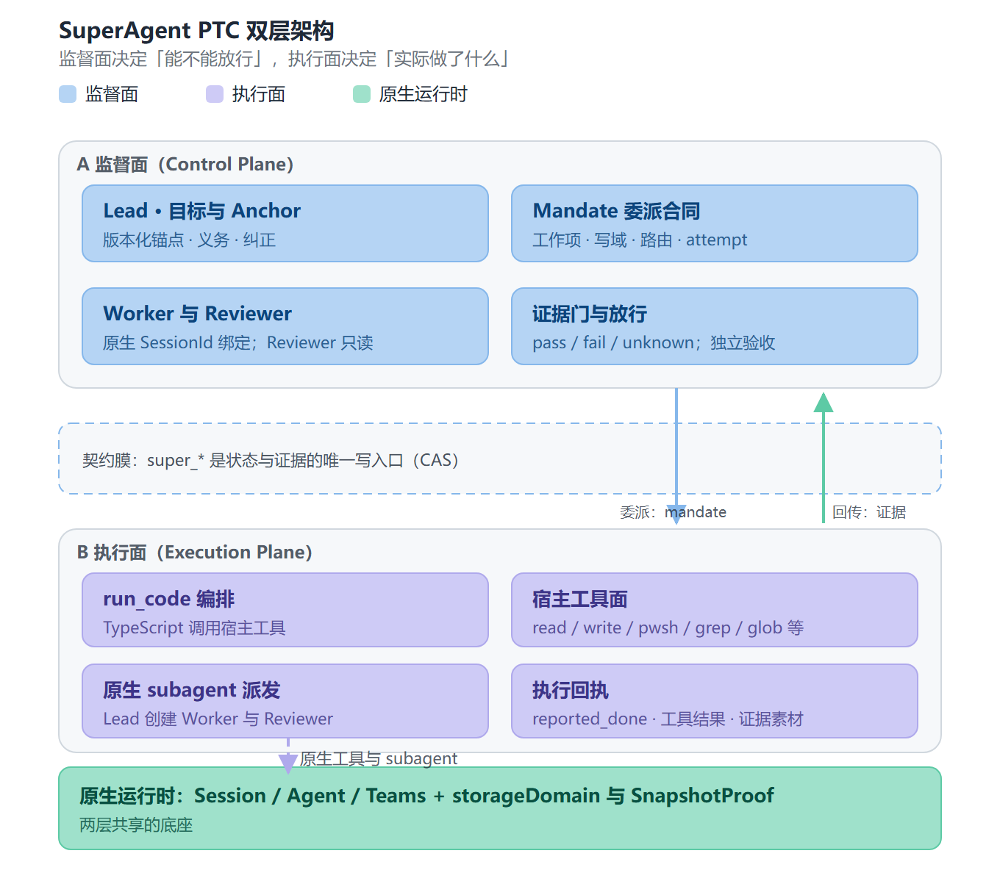
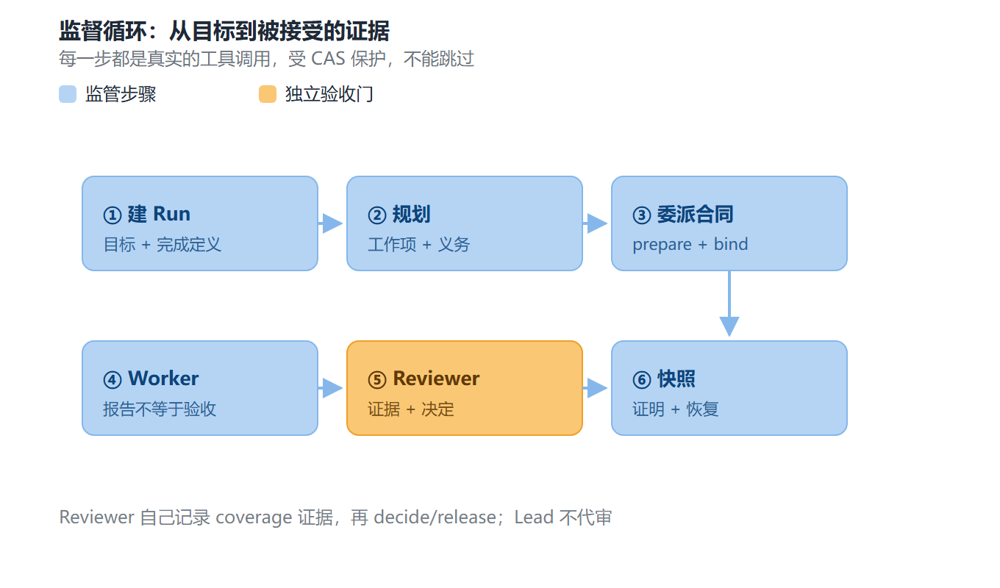
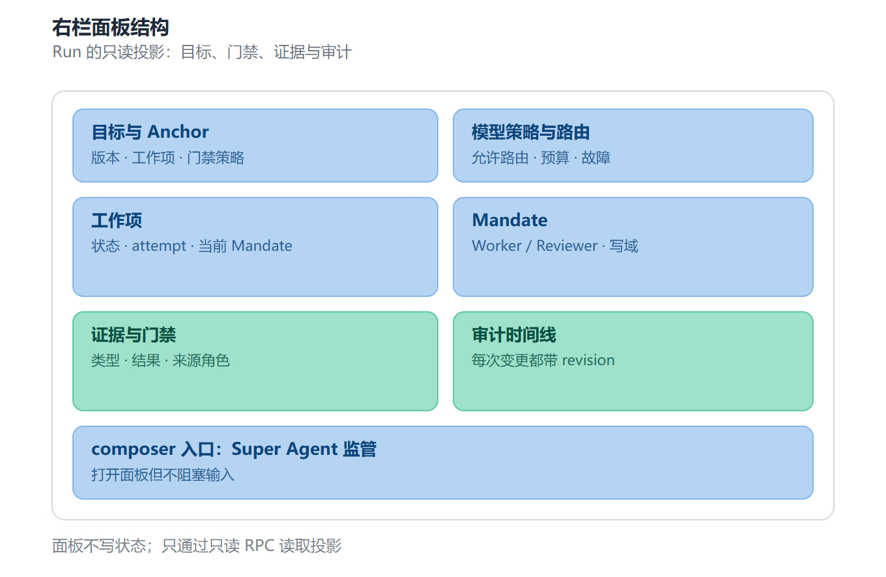

# SuperAgent PTC

[](README.en.md) [](README.md)

[](https://www.npmjs.com/package/dsh-superagent-ptc)
[](https://www.npmjs.com/package/dsh-superagent-ptc)
[](LICENSE)
[](https://github.com/deepseek-ai/deepseek-harness)
[](docs/VALIDATION.md)

> **DeepSeek Harness 的长任务监督层**——版本化锚点、有界委派、独立验收、证据放行。

SuperAgent PTC 把“模型说自己做完了”变成“独立验收者证明它做完了”。它是 **preset-first** 插件：在原生 PTC / Agent / Goal / Teams 运行时之上叠加一层监管，不另造 Agent loop、任务板或路由器。

```text
你：把这份调研拆成三项工作，逐个验收后再写总结
PTC：Run + Anchor  →  逐项 Mandate 派给 Worker  →  standard Reviewer 独立核验
     →  证据通过才放行  →  super_snapshot 返回可验证的 revision 与 proof
```



## 目录

- [为什么需要它](#为什么需要它)
- [特性](#特性)
- [双层架构](#双层架构)
- [监督循环](#监督循环)
- [安装](#安装)
- [快速上手](#快速上手)
- [工具](#工具)
- [右栏面板](#右栏面板)
- [证据门与边界](#证据门与边界)
- [兼容性](#兼容性)
- [验证](#验证)
- [常见问题](#常见问题)
- [开发](#开发)
- [致谢](#致谢)
- [许可](#许可)

## 为什么需要它

长任务失败通常不是“模型不会写”，而是四件事没有被约束：

| 常见问题 | 后果 | SuperAgent PTC 的做法 |
| --- | --- | --- |
| 目标在长对话里漂移 | 做到一半换了题目 | **版本化 Anchor**：目标、完成定义与义务都有版本，纠正会显式失效旧工作 |
| 模型自报完成 | “done” 却没有验证 | `reported_done ≠ accepted`，必须先过独立 Reviewer 与证据门 |
| 委派没有边界 | Worker 越权或重复劳动 | **Mandate 委派合同**：工作项、写域、模型路由与 attempt 在 prepare 时冻结 |
| 崩溃后状态不明 | 不知道哪里可信 | **SnapshotProof + RunState v2**：先写原生证明，再落存储，最后替换 live core |

## 特性

- **Preset-first**：与标准、创造、PTC、极简并列的一个 Agent 预设（`SuperAgent PTC`），不改默认模型、权限或其他会话。
- **七项监管工具**：`super_run`、`super_anchor`、`super_mandate`、`super_evidence`、`super_review`、`super_route`、`super_snapshot`，全部通过 PTC 的 `run_code` 调用，不新增脚本工具。
- **原生身份绑定**：Worker 与 Reviewer 都是真实原生子 Agent；Host 用原生 `sendMessage` 唤醒绑定的 Reviewer，Lead 无法自己扮演验收者。
- **六条 Worker 契约**：每次 `prepare` 都把不静默改道、读后再改、写域不外扩、歧义分级、按验收自验、报告自带证据写入 `mandateText`，供 Lead 原样投递。
- **显式人工交接**：`bind` 后 Lead 用 `super_snapshot` 取当前 CAS、用 `super_mandate show` 读取并原样转发当前 `mandateText`，仅追加一行 `ACTION NOW`；本阶段没有自动 `dispatch`。
- **独立只读验收**：Reviewer 必须使用原生 `standard` 预设；守卫对写操作与未知 shell 一律 fail-closed，`pwsh` 的只读命令（含读取 `$env:`）按实际参数分类。
- **分型证据门**：证据只有 `pass / fail / unknown` 三态；`unknown` 不放行；构建日志、单测与截图不能替代运行时证据。
- **失败预算与可恢复审计**：同一指纹达到预算即阻塞；`super_run recover` 增加 generation 并保留完整审计链。
- **客户端可视化**：右栏监管面板与会话/subagent 区域入口，只读投影；不再注册 composer dock。
- **零全局副作用**：普通会话没有 `super_*` 工具、没有提示词段落、没有面板。

### 明确不做什么

| 不做 | 原因 |
| --- | --- |
| 不重建 Agent loop、任务板或全局路由 | 原生 Session、Agent、Goal、Teams 才是执行权威 |
| 不提供操作系统级文件权限沙箱 | 写域是协作契约，不是内核隔离 |
| 不做自动模型降级 | 只支持显式、白名单、预算内的有界故障切换 |
| 不把 `reported_done` 当作验收 | 只有独立 Reviewer 加证据门才产生 `accepted` |

## 双层架构

**一句话定位**：SuperAgent PTC 在宿主原生 Agent/Session 机制之上叠加一层监管状态机（`Run → Anchor → Mandate → Evidence → Decision`），把原生 agent 会话按角色（Lead / Worker / Reviewer）绑定进这条监管链；**PTC 的原生事件链**（`run_code` 调用与工具回执）**是整条链的证据底座**——监管层自己不产生第二套事件流。

监管面（Control Plane）只回答“能不能放行”，执行面（Execution Plane）只回答“实际做了什么”，两者之间只有一条契约膜：`super_*` 工具是状态与证据的唯一写入口。



- **A 监督面**：Lead 维护 Anchor 与义务账本；Mandate 冻结工作项、写域、路由与 attempt；证据门与预算决定放行。
- **契约膜**：任何状态变更都必须穿过 `super_*` 的 CAS 校验，双层之间没有第二套写路径。
- **B 执行面**：PTC `run_code` 编排宿主工具、原生 `subagent` 创建 Worker 与 Reviewer，回执以 `reported_done` 与工具结果的形式返回。
- **共同底座**：原生运行时提供身份、生命周期与证明；`storageDomain RunState v2` 与 `SnapshotProof` 让 Run 可恢复。

## 监督循环



```text
super_run create            # 目标 + 完成定义 + 门禁策略
super_run plan              # 工作项 / 依赖 / 义务（开放账本）
super_anchor                # 版本化锚点；纠正会失效受影响的工作
super_mandate prepare       # 冻结工作项、写域、模型路由、attempt
super_mandate bind          # 绑定原生 Worker 的 SessionId
# Lead: 用 super_snapshot 取 CAS，用 super_mandate show 取当前 mandateText
#       原生 send_message 原样转发，只追加一行 ACTION NOW，不手抄 ID/CAS
super_evidence record       # Worker 报告执行结果与 build/unit 等真实回执
super_mandate report        # Worker 报告完成，进入 reported_done
super_mandate bindReviewer  # reported_done 后才绑定并唤醒 standard Reviewer
super_evidence verify       # 需要时由 Host 核对实发/实收，生成 coverage 证据
super_review evaluate       # 门禁评估
super_review decide/release # 门禁通过才放行
super_snapshot              # 只读核对 revision / generation / proof
```

### Mandate 交接与 Worker 纪律

`prepareMandate` 除了冻结工作项、anchor/generation/attempt、写域、验收与路由，还固定生成六条 Worker 执行契约：不静默改道、读后再改、写域不外扩、歧义分级、按验收自验、报告自带证据。它们是由 core 生成、测试覆盖的**消息合同**；能否约束真实模型仍须观察原生委派回路。

`bind` 成功后，Lead 先用最新 `super_snapshot` 取得当前 CAS，再用 `super_mandate show` 读取**当前** `mandateText`，通过原生 `send_message` 原样发给已绑定 Worker，只在末尾追加一行 `ACTION NOW: <当前动作>`。不得改写合同、凭记忆手抄 ID/CAS，也不使用尚不存在的 `dispatch`。

需要独立交付核验时，调用 `super_evidence verify` 并指定 `verification=mandate_delivery`，按合同选择 `kind=coverage` 或 `kind=host_contract`。Host 核对当前 Mandate 的实发与 Worker 实收，直接生成带来源引用的证据；coverage obligation 必须显式声明 `verification=mandate_delivery`，一次普通投递不能给“只报告”“旧指令停止”等无关义务盖章。shell 输出的 `result=pass`、Worker 自报 coverage 或未绑定 Reviewer 的自报都不能替代独立验收。

最新 Decision 为 `unknown` 且工作项停在 `verifying` 时，按原合同完整字段显式 replan，开新 attempt 并重新取证，不创建 A2 绕行。确需修订验收合同时，必须由用户明确授权，通过 `super_run replan` 提交 `instruction`、必要 `obligationDelta` 和完整 `workItemRevisions`，生成新 Anchor 后再 plan；旧历史保留，不能借恢复降低门禁。

Worker 在收到完整当前 Mandate 与动作前保持待命；收到后才开工。遇到材料性歧义先升级给 Lead，次要假设写进报告；阻塞、重规划、新 anchor 或新 attempt 时停止旧动作，重新核对最新快照并等待新 Mandate。报告必须区分实际回执、未执行检查和风险。

**边界**：提示词与消息合同不替代 core 状态迁移、原生身份绑定、只读 Reviewer、证据门或写域管理。隔离 profile 中的“待命后开工、只报告已有结果、重规划后旧指令失效”三场景必须单独实测，不能由单元测试推导。

## 安装

要求 DSH `>=0.2.2-rc.5 <0.3.0-0`，Node `^22.19.0 || >=24`。

```bash
# 从 npm 安装到当前 profile
dsh plugin --profile desktop add dsh-superagent-ptc
```

安装后**完全退出并重新启动 DSH**，然后新建会话，在预设选择器中选择 **SuperAgent PTC**。

### 通过 DSH 插件市场索引安装

在 DSH → 设置 → 插件 → 发现 中添加下面的索引 URL，然后搜索 `SuperAgent PTC`：

```text
https://raw.githubusercontent.com/BioAIEvolu/dsh-superagent-ptc/main/market-index.json
```

该索引已通过官方 `parseMarketIndex` 校验，解析为当前 npm 发布版本（与上方 npm 徽章一致）。

### 本地开发安装

```bash
git clone https://github.com/BioAIEvolu/dsh-superagent-ptc.git
dsh plugin --profile desktop add link:/absolute/path/to/dsh-superagent-ptc
```

## 快速上手

1. 新建会话，选择 **SuperAgent PTC** 预设。
2. 把目标与完成标准说清楚，例如：

```text
用 SuperAgent PTC 做最小监管闭环：
super_run create 建 Run；plan 两个工作项，W1 读 README 并给 3 条要点，W2 依赖 W1 本阶段保持 held；
Worker 继承 super-agent，Reviewer 使用 agent_preset=standard；
prepare/bind 后由 Worker 执行并 report；reported_done 后才 bindReviewer，由 Reviewer 独立记录 coverage 证据并 evaluate/decide/release；
最后 super_snapshot 报告真实 Run/WorkItem/Mandate/Evidence/Decision ID 与 revision/generation/proof。
```

3. 通过会话/subagent 区域的 **SuperAgent PTC** 入口打开右栏，查看实时 Run 与审计时间线。

## 工具

| 工具 | 动作 | 说明 |
| --- | --- | --- |
| `super_run` | `create` `plan` `show` `replan` `recover` `complete` | Run 生命周期；`replan` 支持用户授权的合同修订，`recover` 增加 generation 并重新对账 |
| `super_anchor` | `create` `show` `history` | 版本化锚点；纠正会显式失效受影响的工作 |
| `super_mandate` | `prepare` `bind` `bindReviewer` `report` `show` | 委派合同与原生 SessionId 绑定 |
| `super_evidence` | `record` `observe` `verify` `list` | 分型证据与 Host 专项核验，带写域与来源角色校验 |
| `super_review` | `evaluate` `decide` `release` | 独立验收与放行 |
| `super_route` | `show` `set` `inspect` `switch` | 当前 Run 的模型策略与有界故障切换 |
| `super_snapshot` | `{}` | 只读核对 Run / 门禁 / proof / recovery |

每个写动作都带 `expectedRevision` 与 `expectedGeneration`；冲突会被拒绝，而不是静默覆盖。

## 右栏面板



- 面板是**只读投影**：目标/Anchor、模型策略与路由审计、工作项、Mandate、证据与门禁、审计时间线、议程与 attempt。
- 面板不写状态；只有 `super_*` 工具能穿过 Host 的 CAS 校验修改状态。
- 会话/subagent 入口不阻塞输入，普通会话看不到入口与面板。

## 证据门与边界

| 规则 | 行为 |
| --- | --- |
| 证据三态 | 只有 `pass` 可能放行；`fail` 阻塞；`unknown` 绝不当作成功 |
| 来源角色 | 证据必须来自允许的角色与写域；跨项复用的证据会被标为 stale |
| Reviewer 只读 | 写操作、未知 shell、提权指令一律 fail-closed；只读命令按参数分类 |
| 提交顺序 | `SnapshotProof` → `storageDomain` → live core；任一步失败即中止 |
| 恢复 | `recover` 增加 generation，旧证据不复用；只有 root Lead 能处理 quarantine |
| 沙箱范围 | 本插件不提供操作系统级文件沙箱；写域是协作契约 |
| 信任边界 | SnapshotProof 依赖原生会话日志，不防御恶意宿主或直接篡改日志 |

## 兼容性

| 项 | 值 |
| --- | --- |
| DSH | `>=0.2.2-rc.5 <0.3.0-0`（验证基线 `0.2.2-rc.5`） |
| Node | `^22.19.0 || >=24.0.0` |
| 宿主 peer | `dsh-session`、`dsh-storage-domain`、`dsh-tools`、`react` |
| 客户端 | web surface；`@deepseek-ai/dsh-client-connection`、`ui-conversation`、`ui-sidebar-right`、`ui-subagent` |

## 验证

- 自动化：**214 / 214 通过**；`typecheck` 与 `build` 均退出码 0。
- 新增监管回归：`unknown` 后同合同重规划、用户授权的合同修订、PTC 原生实发/实收核验、伪造证据拒绝、Reviewer 完成后唤醒与独立路由切换。
- 真实桌面运行：两个独立 Electron 会话完成监督闭环，包含跨代恢复、多次 Anchor 修订、独立 Reviewer 放行与 SnapshotProof 对齐。
- 修复记录：Reviewer 只读守卫曾把 `pwsh "$env:NAME"` 判为写操作，现按参数分类并带回归测试。
- A 阶段新增六条 Worker 契约及 Lead bind 后原样转发纪律；隔离 profile 的三场景真实委派（待命后开工、只报告已有结果、重规划后旧指令失效）已由独立 native standard Reviewer 放行，原工作项 A 亦已 accepted，详见 [docs/VALIDATION.md](docs/VALIDATION.md)。
- 细节见 [docs/VALIDATION.md](docs/VALIDATION.md)。

### 已知未知

- 真实 provider 故障切换、预算耗尽阻塞、`model.select` 失败分支从未在实机发生，保持 unknown。
- 不提供操作系统级文件沙箱，除会话隔离外没有额外安全边界。

## 常见问题

**选了预设但没有 `super_*` 工具？**
只有 `super-agent` 会话与已验证的只读 Reviewer 才有工具。确认预设确实切换，并完全重启 DSH。

**Reviewer 一直无法 decide？**
看门禁返回：`missingEvidence` / `staleEvidence` 需要补新证据；`REVIEWER_NOT_READONLY` 说明 Reviewer 产生过写回执，需要换一个全新的只读 Reviewer。若 pass decision 后才发现写入，release 会拒绝，且当前 gate=pass 时不能直接 replan/revise；正确顺序是 `super_run recover` 增代 → 同合同 replan → 新 Reviewer、新 attempt、新证据 → decide/release。当前门禁因反证不再 pass 时，才可直接同合同重规划。

**崩溃后怎么恢复？**
root Lead 调用 `super_run recover`；generation 会增加，旧证据不复用，必须在新 generation 重新取证。

**能当全局路由或自动降级用吗？**
不能。`super_route` 只管理当前 Run 的显式策略，没有开箱即用的全局自动路由。

## 开发

```bash
pnpm install
pnpm typecheck && pnpm build && pnpm test
```

- 目录：`src/core`（纯状态机，无 Host 依赖）、`src/host`（工具、守卫、路由、存储）、`src/client`（面板与入口）、`test/`。
- 保持 `typecheck`、`build`、`test` 全绿；核心状态机改动需要正反例。
- Issue 与 PR：https://github.com/BioAIEvolu/dsh-superagent-ptc/issues

## 致谢

这个插件不是凭空想出来的，来自 2026-11-17 一次真实的群聊讨论与源码分享：

- **群友 CC**：分享了 `dsh-plugin-antidrift` 插件源码与真实长任务经验（用 `/goal` 设置长期目标、单次跑过 30+ 小时、一次开 10 个 agent 并行写）。本项目只做源码取证阅读（未安装、未运行、未复制代码），其“锚点 + 委派 + 审计”思路是重要早期启发。
- **桉**：提出“一次性部署多条指令、每几条插入一次小审计、不紧急就继续”，直接对应本项目的工作项 / 证据门 / 失败预算取舍。
- **Electron**：把这种形态认作 PTC 的延伸，促使我们确认“PTC 只有 `run_code`，监管必须建立在原生事件链上”。
- **KOLA 2**：提出定时轮询检查进度、完成即释放下一条命令与审计，以及“主 router 控制 worker”的 SuperAgent 思路，分别影响了 Mandate 的解锁语义与 Lead/Worker/Reviewer 角色划分。

同时感谢上游参考 `zouyuanqing/dsh-super-ptc-mode`（MIT）：参考了其轻量 preset 组合与 Lead 委派理念，persona 与组合已按当前 DSH 契约重写，许可与出处保留在 [NOTICE.md](NOTICE.md)。

也感谢群里持续讨论、提问与纠正的每个人——这些对话让“证据放行”从一句口号变成了可验证的状态机。

## 许可

MIT，见 [LICENSE](LICENSE)。上游 DSH 组件声明记录在 [NOTICE.md](NOTICE.md)。
