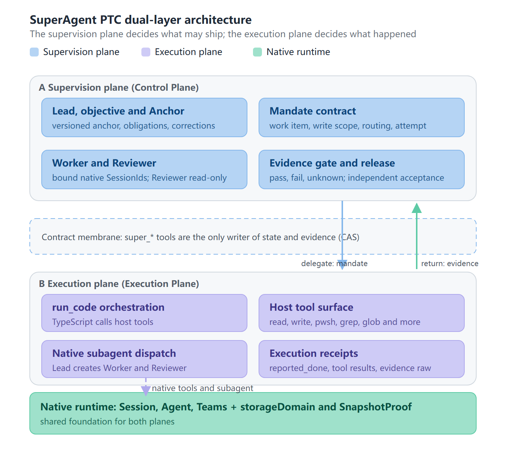
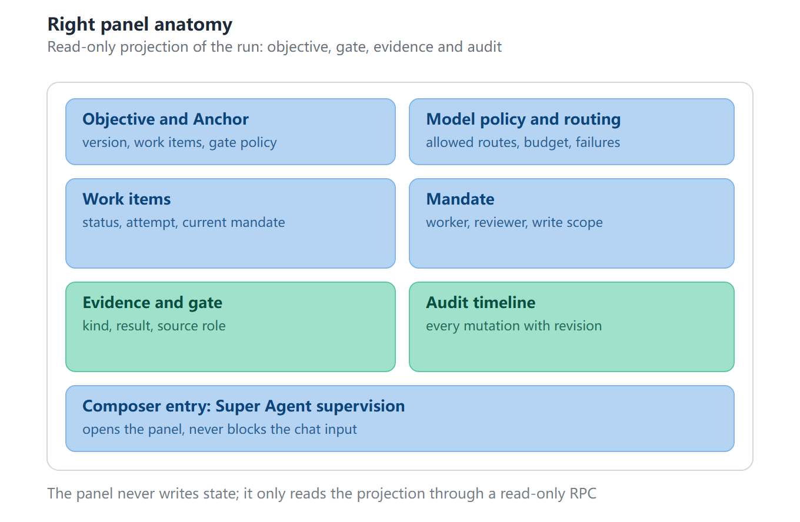

# SuperAgent PTC

[](https://www.npmjs.com/package/dsh-superagent-ptc)
[](https://www.npmjs.com/package/dsh-superagent-ptc)
[](LICENSE)
[](https://github.com/deepseek-ai/deepseek-harness)
[](docs/VALIDATION.md)

> **Long-task supervision layer for DeepSeek Harness** — versioned anchors, bounded delegation, independent acceptance, evidence-gated release.
> **DSH 长任务监督层** —— 目标锚点、有界委派、独立验收、证据放行。

SuperAgent PTC turns "the agent says it is done" into "an independent reviewer proved it is done". It is a **preset-first** plugin: it adds a supervision plane on top of the native PTC / Agent / Goal / Teams runtime instead of building a second agent loop, task board or router.

```
  你：把这份调研拆成三项工作，逐个验收后再写总结
  SuperAgent PTC：Run + Anchor  →  逐项 Mandate 派给 Worker  →  standard Reviewer 独立核验
                   →  证据通过才放行  →  super_snapshot 给出可验证的 revision/proof
```


## 目录

- [为什么需要它](#为什么需要它)
- [特性](#特性)
- [双层架构](#双层架构)
- [监督循环](#监督循环)
- [安装](#安装)
- [快速上手](#快速上手)
- [工具一览](#工具一览)
- [右栏监管面板](#右栏监管面板)
- [证据门与安全边界](#证据门与安全边界)
- [兼容性](#兼容性)
- [验证](#验证)
- [常见问题](#常见问题)
- [开发与贡献](#开发与贡献)
- [许可](#许可)

## 为什么需要它

长任务失败通常不是"模型不会"，而是四件事没有被约束：

| 常见问题 | 后果 | SuperAgent PTC 的做法 |
| --- | --- | --- |
| 目标在长对话里漂移 | 做到一半换了题目 | **版本化 Anchor**：目标、DoD、义务都有版本，纠正会显式失效旧工作 |
| Agent 自报完成 | "done" 但没有验证 | `reported_done ≠ accepted`，必须过独立 Reviewer 与证据门 |
| 委派没有边界 | Worker 越权、重复劳动 | **Mandate 委派合同**：工作项、写域、模型路由、attempt 计数都冻结在合同里 |
| 崩溃后状态不明 | 不知道做到哪，证据是否可信 | **SnapshotProof + RunState v2**：先写原生证明，再落存储，最后替换 live core |

## 特性

- **Preset-first**：与标准、创造、PTC、极简并列的一个 Agent 预设（`SuperAgent PTC`），不改默认模型、权限或其他会话。
- **七项监管工具**：`super_run`、`super_anchor`、`super_mandate`、`super_evidence`、`super_review`、`super_route`、`super_snapshot`，全部通过 PTC 的 `run_code` 调用，不新增脚本工具。
- **原生身份绑定**：Worker / Reviewer 是真实的原生子 Agent；Host 用原生 `sendMessage` 唤醒绑定的 Reviewer，杜绝"Lead 自己扮演 Reviewer"。
- **独立只读验收**：Reviewer 必须是原生 `standard` 预设，guard 对它的写操作和未知 shell 分类 fail-closed；`pwsh` 只读命令（含 `$env:` 读取）按实际参数分类。
- **分型证据门**：证据只有 `pass / fail / unknown` 三态；`unknown` 不放行；build/单测/截图不能替代 runtime 证据。
- **失败预算与可恢复审计**：同 fingerprint 达上限即 blocked；`super_run recover` 增代并保留完整审计链。
- **客户端可视化**：右栏监管面板 + composer 入口，只读投影，不写状态。
- **零全局副作用**：普通会话没有 `super_*` 工具、没有提示词、没有面板。

### 一张表说清"它不做什么"

| 不做 | 原因 |
| --- | --- |
| 不重建 Agent loop / 任务板 / 全局路由 | 原生 Session、Agent、Goal、Teams 才是执行权威 |
| 不提供全局文件权限沙箱 | 写域是协作契约，不是操作系统级隔离 |
| 不做自动模型降级 | 只在显式授权、allowlist 与预算内的有界故障切换 |
| 不把 `reported_done` 当验收 | 独立 Reviewer + 证据门才产生 `accepted` |

## 双层架构

**一句话定位**：SuperAgent PTC 在宿主原生 Agent/Session 机制之上叠加一层监管状态机（`Run → Anchor → Mandate → Evidence → Decision`），把原生 agent 会话按角色（Lead / Worker / Reviewer）绑定进这条监管链；**PTC 的原生事件链**（`run_code` 调用与工具回执）**是整条链的证据底座**——监管层自己不产生第二套事件流。

监管面（Control Plane）只回答"能不能放行"，执行面（Execution Plane）只回答"实际做了什么"，两者之间只有一条契约膜：`super_*` 工具是状态与证据的唯一写入口。



- **A 监督面**：Lead 维护 Anchor 与义务账本；Mandate 冻结工作项、写域、路由与 attempt；证据门与预算决定放行。
- **契约膜**：任何状态变更都必须穿过 `super_*` 的 CAS 校验，双层之间没有第二套写路径。
- **B 执行面**：PTC `run_code` 编排宿主工具、原生 `subagent` 创建 Worker/Reviewer，回执以 `reported_done` 与工具结果的形式返回。
- **共同底座**：原生运行时提供身份、生命周期与证明；`storageDomain RunState v2` 与 `SnapshotProof` 保证崩溃后可恢复。

## 监督循环


```text
super_run create            # 目标 + 完成定义 + 门禁策略
super_run plan              # 工作项 / 依赖 / 义务（开放账本）
super_anchor                # 版本化锚点；纠正时显式失效受影响工作
super_mandate prepare       # 冻结工作项、写域、模型路由、attempt
super_mandate bind          # 绑定原生 Worker SessionId
super_mandate bindReviewer  # 绑定 standard Reviewer，Host 原生唤醒
super_evidence record       # 证据三态，必须可追溯
super_review evaluate       # 门禁评估
super_review decide/release # 通过才放行
super_snapshot              # 只读核对 revision / generation / proof
```

## 安装

要求：DSH `>=0.2.2-rc.3 <0.3.0-0`，Node `^22.19.0 || >=24`。

```bash
# npm 安装到当前 profile
dsh plugin --profile desktop add dsh-superagent-ptc

# 或使用完整包名说明（等价）
dsh plugin --profile desktop add npm:dsh-superagent-ptc
```

安装后**完全退出并重新启动 DSH**，然后新建会话，在预设选择器里选择 **SuperAgent PTC**。

### 通过 DSH 插件市场索引安装

在 DSH → 设置 → 插件 → 发现 中添加索引 URL，然后搜索 `SuperAgent PTC`：

```text
https://raw.githubusercontent.com/BioAIEvolu/dsh-superagent-ptc/main/market-index.json
```

该索引已通过 DSH 官方 `parseMarketIndex` 校验，安装规格为 `dsh-superagent-ptc@0.1.0`。

想先本地试用？把仓库 clone 下来用 `link:` 安装：

```bash
git clone https://github.com/BioAIEvolu/dsh-superagent-ptc.git
dsh plugin --profile desktop add link:/absolute/path/to/dsh-superagent-ptc
```

## 快速上手

1. 新建会话，选择 **SuperAgent PTC** 预设。
2. 直接说清目标与完成标准，例如：

```text
用 SuperAgent PTC 做最小监管闭环：
super_run create 建 Run；plan 两个工作项，W1 读 README 并给 3 条要点，W2 依赖 W1 本阶段保持 held；
Worker 继承 super-agent，Reviewer 用 agent_preset=standard；
prepare/bind/bindReviewer 后由 Reviewer 独立记录 coverage 证据并 evaluate/decide/release；
最后 super_snapshot 报告真实 Run/WorkItem/Mandate/Evidence/Decision ID 与 revision/generation/proof。
```

3. 点击 composer 上方的 **Super Agent 监管**，右栏会显示真实 Run 状态与审计时间线。

## 工具一览

| 工具 | 关键动作 | 说明 |
| --- | --- | --- |
| `super_run` | `create` `plan` `show` `recover` `complete` | Run 生命周期；`recover` 增代并重新对账 |
| `super_anchor` | `show` `apply` `history` | 版本化锚点；纠正时显式失效受影响工作 |
| `super_mandate` | `prepare` `bind` `bindReviewer` `report` `show` | 委派合同与原生 SessionId 绑定 |
| `super_evidence` | `record` `observe` `list` | 证据三态，写域与来源角色校验 |
| `super_review` | `evaluate` `decide` `release` | 独立验收与放行 |
| `super_route` | `show` `set` `inspect` `switch` | 当前 Run 的模型策略与有界切换 |
| `super_snapshot` | `{}` | 只读核对 Run / gate / proof / recovery |

每个写动作都带 `expectedRevision` / `expectedGeneration`，冲突即拒绝，不会静默覆盖。

## 右栏监管面板



- 面板是**只读投影**：`目标/Anchor`、`模型策略与路由审计`、`工作项`、`Mandate`、`证据与门禁`、`审计时间线`、`议程/attempt`。
- 面板不写状态；所有变更只能由 `super_*` 工具穿过 Host 的 CAS 校验完成。
- composer 入口不阻塞输入，普通会话看不到该入口。

## 证据门与安全边界

| 规则 | 行为 |
| --- | --- |
| 证据三态 | `pass` 才可能放行；`fail` 阻塞；`unknown` 不当作通过 |
| 来源角色 | 证据必须来自允许的角色与写域，跨项复用的旧证据会被标记 stale |
| Reviewer 只读 | 写操作、未知 shell、权限提升指令一律 fail-closed；只读命令按参数分类 |
| 提交顺序 | `SnapshotProof` → `storageDomain` → live core；任一步失败即中止 |
| 恢复 | `recover` 增加 generation，旧证据不复用；quarantine 只允许 root Lead 处理 |
| 沙箱边界 | 本插件**不提供**操作系统级文件权限沙箱，写域是协作契约 |
| 信任边界 | SnapshotProof 依赖原生会话日志，不防御恶意宿主或直接篡改原生日志 |

## 兼容性

| 项 | 值 |
| --- | --- |
| DSH | `>=0.2.2-rc.3 <0.3.0-0`（开发与验证基线 `0.2.2-rc.5`） |
| Node | `^22.19.0 || >=24.0.0` |
| 宿主侧 peer | `dsh-session`、`dsh-storage-domain`、`dsh-tools`、`react` |
| 客户端 | web surface，`@deepseek-ai/dsh-client-connection`、`ui-conversation`、`ui-sidebar-right`、`ui-subagent` |

## 验证

- 自动化：**176 / 176 pass**，`typecheck` 与 `build` 均 exit 0。
- 真实桌面链路：两条独立 Electron 会话完成监督闭环，含跨代恢复（generation 1→4）、多次 Anchor 修订、独立 Reviewer 放行与 SnapshotProof 对齐。
- 修复记录：Reviewer 只读 guard 曾把 `pwsh "$env:NAME"` 误判为写操作；已按实际参数分类并加入回归用例。
- 详细证据摘要见 [docs/VALIDATION.md](docs/VALIDATION.md)。

### 明确未覆盖

- 真实 provider 故障下的自动切换、预算耗尽 blocked、`model.select` 失败分支：尚未在实机发生，保持 unknown。
- 未提供全局文件权限沙箱；不承诺跨会话隔离之外的安全边界。

## 常见问题

**Q：选了预设但没有 `super_*` 工具？**
只有 `super-agent` 会话与已绑定且验证过的只读 Reviewer 才拿到工具；确认预设确实切换成功，并完全重启 DSH。

**Q：Reviewer 一直无法 decide？**
查看门禁返回的 `missingEvidence` / `staleEvidence` / `REVIEWER_NOT_READONLY`：前者补证据，后者说明 Reviewer 有过写回执，需换新的只读 Reviewer。

**Q：崩溃后 Run 状态怎么恢复？**
root Lead 调用 `super_run recover`；generation 会增加，旧证据不复用，需要在新 generation 重新取证。

**Q：能当全局路由/自动降级用吗？**
不能。`super_route` 只管理当前 Run 的显式策略；没有 out-of-the-box 的全局自动路由。

## 开发与贡献

```bash
pnpm install
pnpm typecheck && pnpm build && pnpm test
```

- 目录：`src/core`（纯状态机，无 Host 依赖）、`src/host`（工具、guard、routing、存储）、`src/client`（面板与入口）、`test/`。
- 提交前请保持 `typecheck`、`build`、`test` 全绿；核心状态机改动需补正反例。
- 欢迎 Issue / PR：https://github.com/BioAIEvolu/dsh-superagent-ptc/issues

## 致谢

这个插件的方向不是凭空想出来的，来自 2026-11-17 一次真实的群聊讨论与源码分享：

- **群友 CC**：分享了 `dsh-plugin-antidrift` 插件源码，并给出真实的长任务经验——用 `/goal` 设置长期目标、单次跑过 30+ 小时、一次开 10 个 agent 并行写。本项目对其源码只做取证阅读（未安装、未运行、未复制代码），其“锚点 + 委派 + 审计”的思路是重要的早期启发。
- **桉**：提出“一次性部署多条指令、每几条插入一次小审计、不紧急就继续”的节奏，直接对应本项目“工作项 + 证据门 + 失败预算”的取舍。
- **Electron**：在讨论中把这种形态认作 PTC 模式的延伸，促使我们确认“PTC 只有 `run_code`，监管必须建立在其原生事件链之上”。
- **KOLA 2**：提出“定时轮询检查进度、完成就释放下一条命令与审计”，以及“主 router 控制 worker 干活”的 SuperAgent 思路，这两点分别影响了 Mandate 的解锁语义与 Lead/Worker/Reviewer 的角色划分。

另外感谢上游参考 `zouyuanqing/dsh-super-ptc-mode`（MIT）：本项目参考了其轻量 preset 组合方式与 Lead 委派理念，persona 与组合已按当前 DSH 契约重写，许可与出处保留在 [NOTICE.md](NOTICE.md)。

以及所有在群里继续讨论、提问和纠正的人——这些对话让“证据放行”从一句口号变成了可验证的状态机。

## 许可

MIT License，见 [LICENSE](LICENSE)。上游 DSH 组件版权与来源见 [NOTICE.md](NOTICE.md)。
